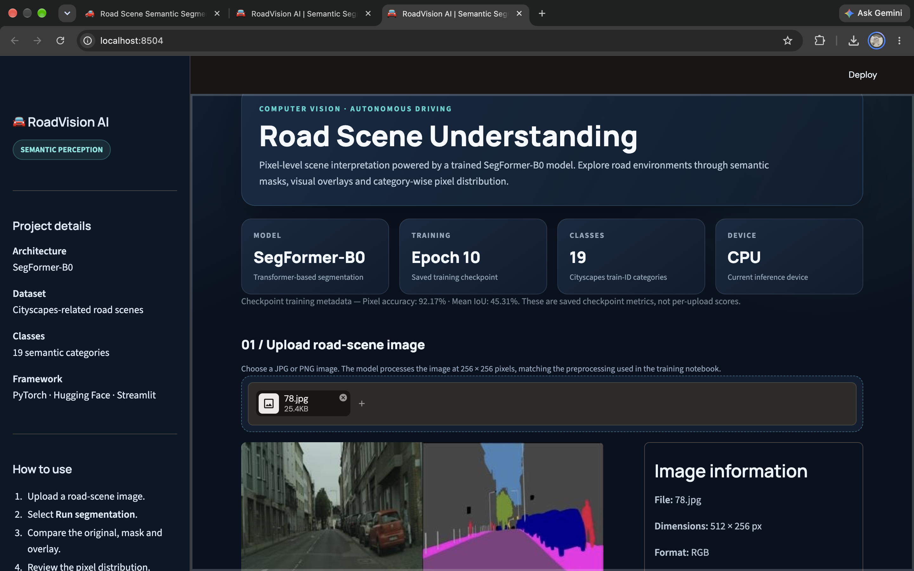
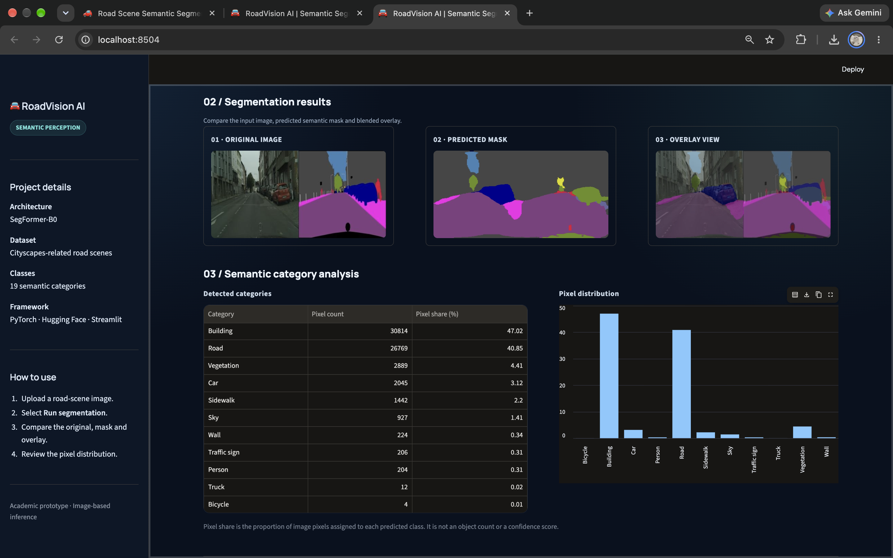

# 🚗 RoadVision AI
### Real-Time Semantic Segmentation for Autonomous Driving

A computer vision project that performs pixel-level semantic segmentation of road scenes using a fine-tuned **SegFormer-B0** deep learning model.

RoadVision AI identifies and classifies objects and regions in road images into 19 semantic categories, helping interpret road environments for autonomous driving applications.

---

## 📌 Project Overview

Traditional image classification identifies objects in an image but does not show their exact locations. Semantic segmentation addresses this limitation by assigning a class label to every pixel.

This project uses a SegFormer-B0 architecture trained on a Cityscapes-related road-scene dataset to generate semantic segmentation masks and visualize the results through an interactive Streamlit application.

## ✨ Key Features

- Upload road-scene images in JPG or PNG format.
- Generate pixel-level semantic segmentation predictions.
- Visualize the original image, predicted mask, and blended overlay.
- Identify detected semantic categories.
- Calculate pixel counts and percentage distribution for each detected category.
- Display an interactive visual analysis through a Streamlit dashboard.

## 🧠 Model and Methodology

| Component | Description |
|---|---|
| Architecture | SegFormer-B0 |
| Task | Semantic Segmentation |
| Dataset | Cityscapes-related road-scene dataset |
| Number of classes | 19 |
| Training | 10 epochs |
| Loss function | Cross Entropy Loss |
| Optimizer | AdamW |
| Framework | PyTorch |
| Interface | Streamlit |

### Semantic Categories

The model classifies road-scene pixels into 19 categories:

Road, Sidewalk, Building, Wall, Fence, Pole, Traffic Light, Traffic Sign, Vegetation, Terrain, Sky, Person, Rider, Car, Truck, Bus, Train, Motorcycle, and Bicycle.

## 📊 Model Performance

The saved Epoch 10 checkpoint contains the following training metadata:

| Evaluation Metric | Value |
|---|---:|
| Pixel Accuracy | 92.17% |
| Mean Intersection over Union (mIoU) | 45.31% |
| Training Epochs | 10 |

*Note: These values are the metrics stored in the saved checkpoint. They are not individual image-upload prediction scores.*

## 🖥️ Application Dashboard

The Streamlit application provides an interactive interface for uploading images and exploring semantic segmentation results.



## 🔍 Segmentation Results

The application presents three visual outputs:

1. Original road-scene image
2. Predicted semantic segmentation mask
3. Blended overlay combining the original image and predicted mask

It also displays detected categories and their pixel distribution.



## 🛠️ Technology Stack

- **Python** – Main programming language
- **PyTorch** – Deep learning model development
- **Hugging Face Transformers** – SegFormer architecture
- **NumPy** – Numerical operations
- **Pillow** – Image processing
- **Streamlit** – Interactive application development

## 📂 Project Structure

```text
real-time-semantic-segmentation/
│
├── app.py
├── roadvision_ai_app_refined.py
├── evaluate_model.py
├── requirements.txt
├── README.md
│
├── dashboard.png
└── segmentation_results.png
```

The trained model checkpoint is maintained separately and is not included in this repository.

## ⚙️ Running the Application Locally

### 1. Clone the repository

```bash
git clone https://github.com/sherlyravi2-cmyk/real-time-semantic-segmentation.git
cd real-time-semantic-segmentation
```

### 2. Create and activate a virtual environment

```bash
python3 -m venv .venv
source .venv/bin/activate
```

### 3. Install dependencies

```bash
pip install -r requirements.txt
```

### 4. Add the trained model checkpoint

Place `image_segmentation_epoch10.pth` in the project directory, alongside the application file.

### 5. Launch the application

```bash
streamlit run roadvision_ai_app_refined.py
```

Open the local URL displayed in the terminal to access the application.

## 🎯 Project Objective

The objective of this project is to explore transformer-based semantic segmentation for road-scene understanding and develop an interactive prototype that visualizes pixel-level predictions.

## 🚀 Future Enhancements

- Integrate live camera input for real-time scene analysis.
- Optimize inference speed for deployment.
- Improve segmentation accuracy across challenging road conditions.
- Explore deployment on edge devices.

## 👩‍💻 Author

**Sherly R**

Project: Real-Time Semantic Segmentation for Autonomous Driving

---

*Developed as an academic computer vision project using deep learning and interactive visualization.*
